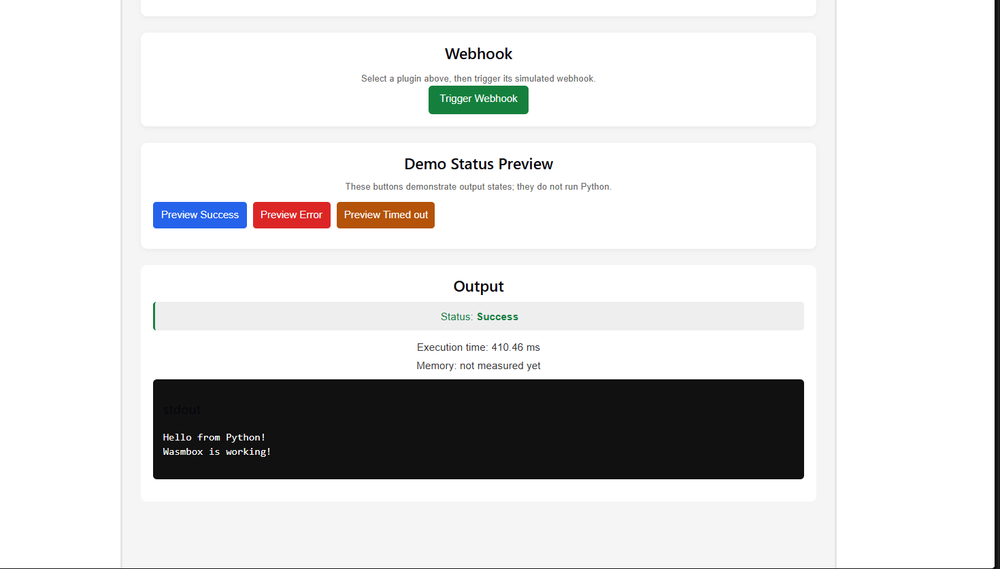
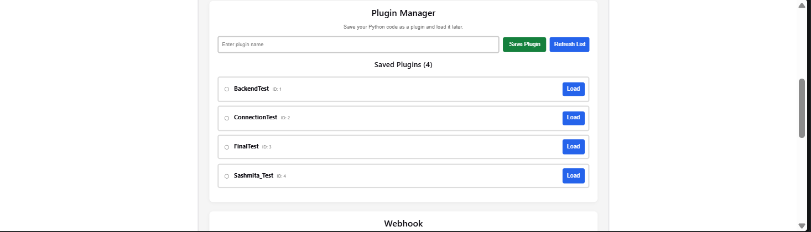
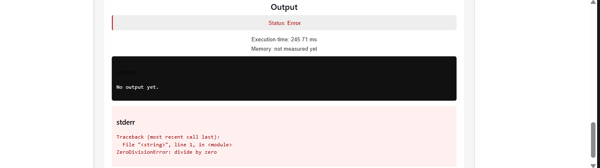
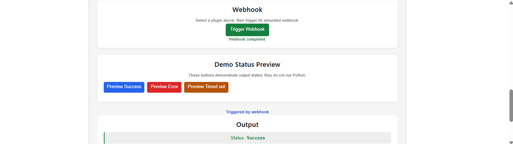

# WasmBox Sandbox

A working prototype for writing, running, saving, and loading Python plugins through a browser-based interface. The backend executes Python using a MicroPython WASI interpreter inside Wasmtime and returns structured execution results.

## 1. Features

- **Python editor:** Write Python in the browser using Monaco Editor.
- **Code execution:** Submit code to the FastAPI backend and display execution output and errors.
- **Plugin management:** Save, list, and load named Python plugins using SQLite persistence.
- **Simulated webhook:** Trigger a saved plugin through the `/webhooks/{id}` API endpoint. This simulates a webhook trigger; it is not an integration with an external webhook provider.
- **Execution results:** Display execution status, standard output, standard error, and available metrics.
- **Demo status previews:** The Preview Success, Preview Error, and Preview Timed out buttons demonstrate output-panel states. They do not execute Python code.

## 2. Execution statuses

The backend currently returns these four execution statuses:

| API status | Meaning | Frontend presentation |
|---|---|---|
| `ok` | The program completed successfully. | Success state and captured standard output. |
| `error` | The program encountered a Python/runtime error or another execution failure. | Error state with diagnostic text in the output panel. |
| `timeout` | Execution was interrupted by the wall-clock deadline or instruction-fuel limit. | Timed-out state and the runner's timeout message. |
| `memory_exceeded` | The MicroPython heap or Wasmtime guest-memory limit was exceeded. | Memory-limit failure surfaced in the output panel. |

The frontend displays friendly labels for these outcomes while the API retains the status values shown above. The older `denied` value remains in the API schema for compatibility, but the current runner does not emit it for ordinary guest errors or the tested resource-limit cases.

## 3. Technology stack

| Component | Technology |
|---|---|
| Frontend | React, Vite, Monaco Editor |
| Backend API | Python 3.12, FastAPI, Pydantic |
| WebAssembly runtime | Wasmtime |
| Python interpreter | MicroPython compiled for WASI |
| Plugin storage | SQLite |
| Backend tests | pytest |
| Frontend build | Node.js 20, npm, Vite |

## 4. Prerequisites

Install these tools before setting up the project:

- Git
- **Python 3.12** — CI and Docker use this version.
- **Node.js 20** — CI uses this version.
- npm, included with Node.js.
- Docker Desktop (optional; used for isolated Linux and resource-limit verification).

Check your versions:

```powershell
python --version
node --version
npm --version
```

Use Python 3.12 and Node.js 20 for the documented setup.

## 5. Clone the repository

```powershell
git clone https://github.com/prathamesh-shirdhankar/wasmbox-sandbox.git
cd wasmbox-sandbox
```

Run the remaining commands from the repository root unless a step says otherwise.

## 6. Create the Python environment

A fresh clone does not contain the local virtual environment. Create it before trying to activate it:

```powershell
py -3.12 -m venv .venv
.\.venv\Scripts\Activate.ps1
python --version
python -m pip install -r backend/requirements.txt
```

The Python version should report `3.12.x`.

If PowerShell blocks activation scripts, use an appropriate current-user execution policy, such as:

```powershell
Set-ExecutionPolicy -Scope CurrentUser RemoteSigned
```

Then reopen the terminal and activate the environment again.

## 7. Install and run the frontend

Open a second terminal at the repository root:

```powershell
cd frontend
npm ci
npm run dev
```

Open the Vite development URL shown in the terminal, normally:

```text
http://localhost:5173
```

To check the production build:

```powershell
npm run build
```

## 8. Start the backend

In the first terminal, from the repository root, activate the environment and start FastAPI:

```powershell
.\.venv\Scripts\Activate.ps1
python -m uvicorn app.main:app --reload --app-dir backend
```

The backend normally listens at:

```text
http://localhost:8000
```

Check that it is responding:

```powershell
Invoke-RestMethod http://localhost:8000/health
```

Expected response:

```json
{
  "ok": true
}
```

Keep both the backend and frontend terminals running while using the application.

## 9. API endpoints

| Method | Endpoint | Purpose |
|---|---|---|
| `GET` | `/health` | Check backend health. |
| `POST` | `/run` | Execute submitted Python code. |
| `POST` | `/plugins` | Save a named plugin. |
| `GET` | `/plugins` | List saved plugins. |
| `GET` | `/plugins/{id}` | Load a saved plugin and its source code. |
| `POST` | `/webhooks/{id}` | Simulate a webhook trigger for a saved plugin. |

The execution endpoint accepts JSON in this form:

```json
{
  "code": "print('Hello from WasmBox!')"
}
```

The standard execution response contains five fields:

```json
{
  "status": "ok",
  "stdout": "Hello from WasmBox!\n",
  "stderr": "",
  "exec_ms": 1.42,
  "mem_bytes": 2293760
}
```

The numeric values above are illustrative, not fixed performance or memory guarantees.

### Input validation

- Code is limited to **10,000 characters**.
- Empty or whitespace-only code returns an execution error.
- A missing required `code` field produces an HTTP `422` validation response, rather than the normal five-field execution response.
- Oversized code submitted to `/run` is rejected before execution.
- Plugin names must contain between 1 and 100 characters.

## 10. Execution and resource limits

The runner applies these default limits:

| Limit | Default | Meaning |
|---|---:|---|
| Maximum source length | 10,000 characters | Rejects oversized submissions before execution. |
| Wall-clock timeout | 250 ms | Interrupts execution when the configured time deadline is reached. |
| Wasmtime instruction fuel | 30,000,000 units | Bounds instrumented WebAssembly execution work. |
| Wasmtime Store memory | 10 MiB | Limits guest WebAssembly linear memory. |
| MicroPython heap | 2 MiB | Limits the Python heap inside the interpreter. |

The timeout uses Wasmtime epoch interruption with a ticker interval of approximately 5 ms. Actual interruption timing can vary with scheduling. Fuel exhaustion and wall-clock interruption both currently map to `timeout`; the API message does not identify which one caused a particular interruption.

The Wasmtime Store memory limit and MicroPython heap setting are separate controls. A Python program can encounter a MicroPython `MemoryError` without using the full Wasmtime linear-memory allowance.

## 11. Execution metrics and performance

### `exec_ms`

`exec_ms` measures the runner's timed execution segment: **WASM instantiation and guest execution**.

It does not measure the complete HTTP request. It excludes:

- Shared Wasmtime Engine and compiled Module initialization.
- Waiting to acquire the process-wide runner lock.
- Per-run Store, Linker, and WASI setup.
- Python source packaging and custom-section extraction.
- HTTP, network, and frontend overhead.

A small `exec_ms` value must therefore not be interpreted as the total time a user waits for a request.

### `mem_bytes`

`mem_bytes` is the size of the guest's WebAssembly linear memory at the end of the run. WebAssembly linear memory only grows during execution, so this is also the largest linear-memory size reached during that run.

It is **not the amount of memory actually used by the Python program**, nor is it total host-process or container memory.

### Benchmark evidence

The short live-HTTP benchmark recorded in `docs/LOAD_TEST.md` used `print(42)` on Windows AMD64 with Python 3.12.10. All 36 requests succeeded.

| Concurrency | Successful requests | HTTP p95 | Runner `exec_ms` p95 | Throughput |
|---:|---:|---:|---:|---:|
| 1 | 1/1 | One request: 192.89 ms | One sample: 1.42 ms | 2.43 req/s |
| 5 | 5/5 | 18.31 ms | 0.62 ms | 10.55 req/s |
| 10 | 10/10 | 22.45 ms | 0.77 ms | 16.18 req/s |
| 20 | 20/20 | 30.85 ms | 0.68 ms | 16.83 req/s |

For this short workload, the measured runner segment was below 50 ms in every batch. This is evidence for the **measured runner segment under the tested conditions**, not proof of a sub-50 ms cold start or end-to-end HTTP request. The first HTTP request took approximately 193 ms.

These are short benchmark results from one development environment, not sustained stress-test results or a production-capacity guarantee. See [`docs/LOAD_TEST.md`](docs/LOAD_TEST.md) for the full methodology, measurements, and limitations.

## 12. SQLite plugin storage

Saved plugins are stored locally in:

```text
backend/wasmbox_plugins.db
```

The database path is derived from the storage module's file location, not the server's current working directory. Starting Uvicorn from the repository root or from another directory does not intentionally create a separate database.

The SQLite file is local and excluded from version control. Saved plugins persist across backend restarts as long as the same database file is retained.

### Reset saved plugins

Stop the backend first. Then, from the repository root in PowerShell:

```powershell
Remove-Item .\backend\wasmbox_plugins.db -ErrorAction SilentlyContinue
Remove-Item .\backend\wasmbox_plugins.db-wal -ErrorAction SilentlyContinue
Remove-Item .\backend\wasmbox_plugins.db-shm -ErrorAction SilentlyContinue
```

The database is recreated when the application next initializes storage. **This permanently deletes the saved plugins in that local database.**

## 13. Security and known limitations

WasmBox is a prototype, not a production-ready multi-user service.

- There is **no login or authentication**.
- There is **no rate limiting**.
- Users of the same backend instance share one SQLite database; plugin records are not separated by user identity.
- The SQLite database is stored locally and is **not encrypted at rest**.
- The webhook endpoint is simulated; it is not a secured external webhook integration.
- The current security tests cover selected behaviors. They are not an exhaustive penetration test or proof that every attack is prevented.
- The automated memory-bomb pytest is skipped because it requires an isolated environment with an explicit process/container memory cap. A separate bounded Docker test was performed and verified the `memory_exceeded` response and subsequent recovery.
- The project has not been certified for untrusted public internet traffic or production multi-tenant workloads.

**Do not expose this application to the public internet or use it to host untrusted users.** Additional authentication, authorization, rate limiting, isolation, monitoring, and deployment security work would be required first.

## 14. Troubleshooting

### Backend port 8000 is already in use

A previous `python.exe` or Uvicorn process may still be listening on port 8000.

Find the process:

```powershell
Get-NetTCPConnection -LocalPort 8000 -State Listen |
    Select-Object LocalAddress, LocalPort, OwningProcess
```

Inspect the reported process ID:

```powershell
Get-Process -Id <PID>
```

Only after confirming it is the stale WasmBox/Uvicorn process, stop it:

```powershell
Stop-Process -Id <PID>
```

Then start the backend again.

### Frontend cannot reach the backend

1. Confirm the backend terminal is still running.
2. Check `http://localhost:8000/health`.
3. Confirm the frontend is using the expected backend URL.
4. Check the browser's Network and Console panels for the failed request.

### Python environment activation fails

Confirm that the virtual environment exists:

```powershell
Test-Path .\.venv\Scripts\Activate.ps1
```

If it does not exist, create it using the commands in Section 6.

### Saved plugins appear to be missing

Confirm that the backend is using the expected repository checkout and that this file exists:

```text
backend/wasmbox_plugins.db
```

The database is local to the checkout. A different clone can have a different database file.

## 15. Third-party licence

The bundled MicroPython WASI interpreter is supplied through **`micropython-wasm` version `0.1a2`**, under the **Apache License 2.0**.

The repository includes the associated licence at:

```text
backend/app/runtime/artifacts/LICENSE
```

Retain that licence file and its attribution when redistributing the bundled interpreter artifact. Other Python and JavaScript dependencies are identified in `backend/requirements.txt` and the frontend package manifests; consult their respective licence notices.

## 16. Screenshots

The following screenshots illustrate the browser interface. Add the image files to `docs/screenshots/` in the repository and commit them so GitHub can render the images.










The screenshots show the UI at the time they were captured. They are illustrative and do not replace the API or test evidence described above.

## 17. Project snapshot and release

**Project snapshot:** as of 29 October 2026.

**Latest recorded verification:** 5 November 2026. See the testing and benchmark reports in `docs/` for the evidence and limitations recorded after the project snapshot.

**Proposed final release tag:** `v1.0.0`.

Create and push the tag only after the final documentation changes have been reviewed and merged. Use the release tag to identify the final version rather than hard-coding a commit hash in this README.

